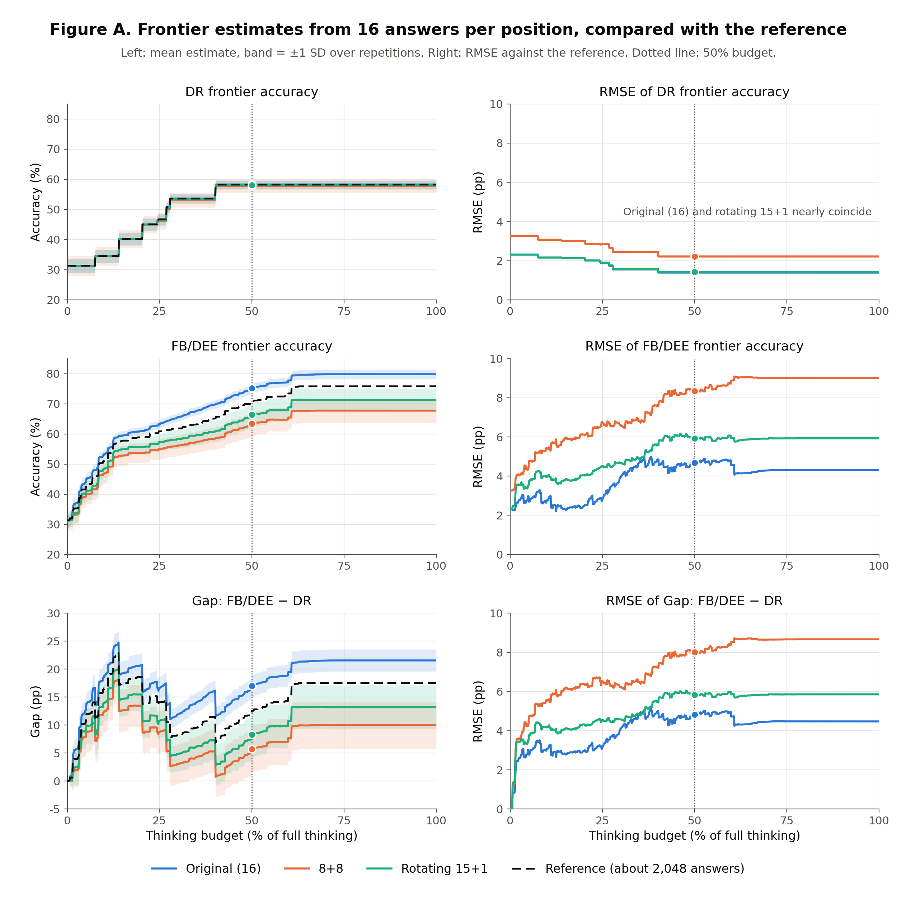

# Figures for the author response

## Figure A

Frontier estimates from 16 answers per position, compared with the reference built from about 2,048 answers per position. Left: mean and ±1 SD over repetitions. Right: RMSE. [PDF](figures/fig_a_frontier_uncertainty.pdf)

## Figure B

DEE frontier at probing resolutions b = 128, 256 and 512. Circles mark the budget at which each frontier reaches its maximum accuracy. [PDF](figures/fig_b_resolution_frontiers.pdf)

## Figure C

Nine online methods and the oracle frontier of their class (black); the gray curves are the frontiers of the other two classes. Frontiers are plotted against the budget cap, methods against their actual cost. Open markers: all tested settings; the lines joining them are a visual guide. Filled markers: settings selected on development data. Methods marked * were added in the response. [PDF](figures/fig_c_methods_vs_frontiers.pdf)
