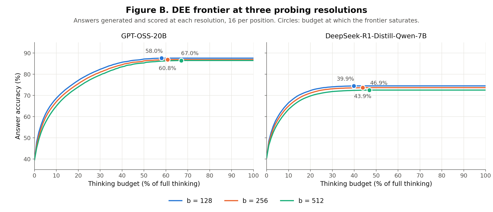
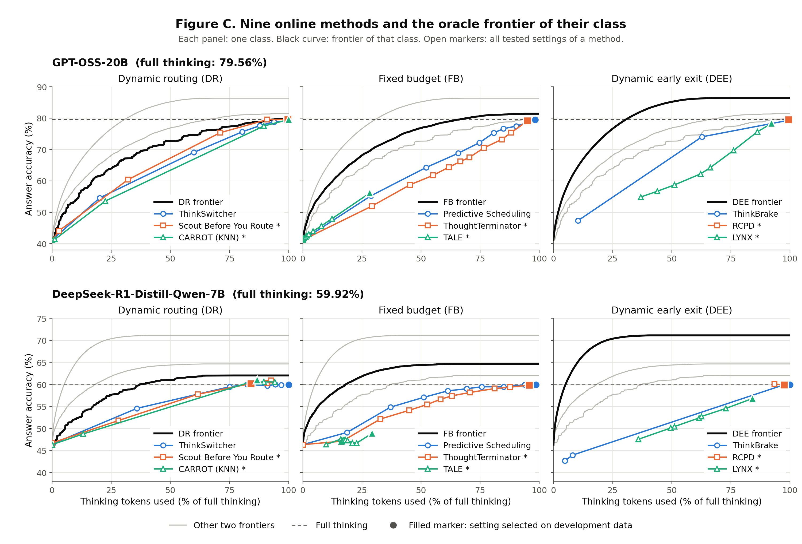

# Supplementary figures for the author response (ICLR 2027 submission 61431)

This anonymous repository contains only the three figures referenced in the author response. All numbers needed to follow the response are given in the tables of the OpenReview comments.

## Figure A. Uncertainty of the frontier estimates at an equal probe budget

Rows: DR accuracy, FB/DEE accuracy, and the gap FB/DEE − DR. Left: mean estimate with a band of ±1 SD over repetitions; the black dashed curve is the reference built from about 2,048 answers per position. Right: RMSE against the same reference. All three estimators use 16 answers per position: "Original (16)" selects and scores with all 16; "8+8" selects with eight and scores with the other eight; "Rotating 15+1" selects with fifteen, scores with one, and averages over the 16 choices of the held-out answer. 8,192 repetitions on 16 trajectories from two models and four benchmarks, averaged over the eight model–benchmark groups. FB and DEE coincide because each question has one trajectory. The markers at a 50% budget correspond to the table in the response to Reviewer w43A, W2. [PDF](figures/fig_a_frontier_uncertainty.pdf)

## Figure B. DEE frontiers at probing resolutions b = 128, 256 and 512

Each panel shows one model, averaged over four benchmarks with equal weight, with 16 answers per position. Circles mark the smallest budget at which each frontier reaches its maximum accuracy. With one trajectory per question, FB coincides with DEE, and DR does not depend on b. See the response to Reviewer bSdV, Q2. [PDF](figures/fig_b_resolution_frontiers.pdf)

## Figure C. Nine online methods and the oracle frontier of their class

Rows are models and columns are classes: dynamic routing (DR), fixed budgets (FB) and dynamic early exit (DEE). Each model is averaged over four benchmarks with equal weight. In each panel the black curve is the oracle frontier of that class, and the two gray curves are the frontiers of the other two classes. Colored curves with open markers show all tested parameter settings of each method at their actual cost; the filled marker is the setting selected on development data, which is the one reported in the table of the response. The dashed line is full thinking. Methods marked * were added in the rebuttal. The frontier curves use a common relative budget for the four benchmarks, whereas methods spend different shares of their budget on each benchmark; vertical distances in this figure therefore differ slightly from the matched same-cost gaps reported in the response to Reviewer w43A, W3, and a few method points lie marginally above the averaged DR frontier. [PDF](figures/fig_c_methods_vs_frontiers.pdf)
